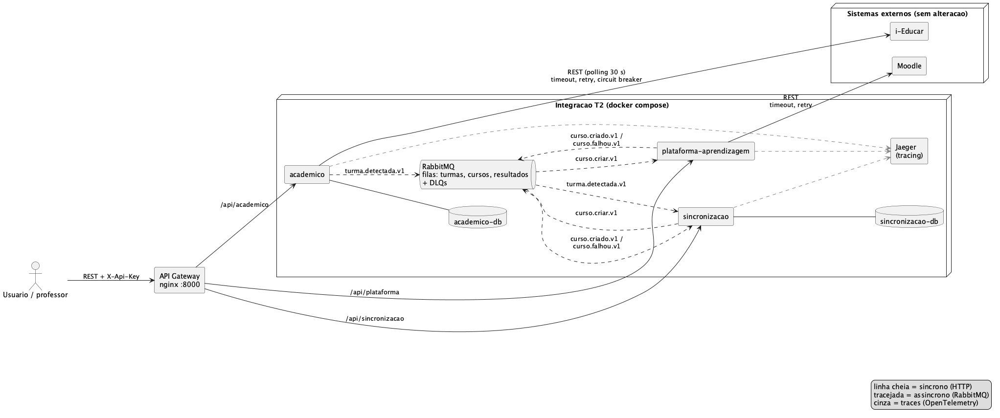
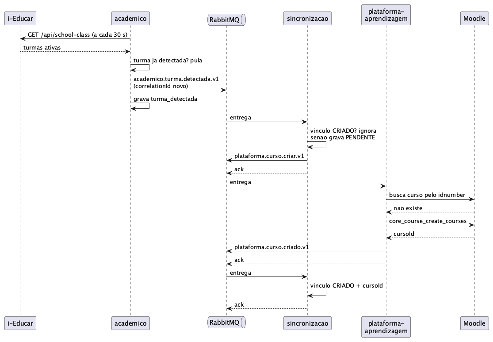

# T2 – Integração i-Educar → Moodle em microsserviços

**Autores:** Juliano Machado da Silva e João Pedro Madruga

O T2 é a continuação do T1. A mesma integração (cada turma ativa do i-Educar vira um curso no Moodle) saiu de um monólito modular e virou **3 microsserviços que se comunicam por mensagens** (RabbitMQ). O sistema tolera falhas e pode ser observado em execução.



| Documento | Conteúdo |
|---|---|
| [docs/architecture.md](docs/architecture.md) | Serviços, catálogo de eventos, filas e comparação com o T1 |
| [docs/adr/](docs/adr/) | Decisões: decomposição, comunicação, resiliência, stack e API Gateway |
| [docs/failure-scenarios.md](docs/failure-scenarios.md) | Os 4 cenários de falha e como reproduzir cada um |
| [arquivos T1/](arquivos%20T1/) | Tudo do T1: README, enunciado, relatório, Resumo das Escolhas Arquiteturais e o monólito (`integration/`) |

## Como rodar

Pré-requisito: Docker com Docker Compose.

```bash
docker compose up -d
```

Esse único comando sobe tudo: i-Educar, Moodle, RabbitMQ, os bancos, os 3 serviços, o API Gateway e o Jaeger.

- O container `configurador` roda uma vez: instala o i-Educar com dados de exemplo e liga a API do Moodle.
- **Na primeira vez leva alguns minutos** (build das imagens e instalação do Moodle). Nas seguintes, segundos.
- Para acompanhar: `docker compose ps` (os serviços ficam `healthy`) ou `docker compose logs -f configurador`.
- Atalho opcional: `./instalar.sh` (no Windows, duplo clique em `instalar.bat`) faz o mesmo `docker compose up` e espera tudo responder.

Em até 30 segundos depois de subir, as turmas de exemplo do i-Educar já aparecem como cursos no Moodle.

### Conferir se está funcionando

1. `docker compose ps`: o `configurador` aparece como `Exited (0)`, e `academico`, `sincronizacao` e `plataforma-aprendizagem` como `healthy`.
2. `curl -H "X-Api-Key: projac" http://localhost:8000/api/sincronizacao/vinculos`: as turmas aparecem com `"status":"CRIADO"`.
3. Moodle em http://localhost:8080 (`user` / `bitnami`) → **Site administration → Courses → Manage courses and categories**: os cursos estão lá.
4. `./testar-integracao.sh`: cria uma turma, espera o curso aparecer, confere e apaga o que criou. Termina com `OK`.

Se algo não subir, `docker compose logs configurador` mostra em que passo a instalação parou.

## Acessos

Tokens e senhas são fixos de propósito: é um trabalho acadêmico para rodar em qualquer máquina.

| O quê | Endereço | Login / chave |
|---|---|---|
| i-Educar | http://localhost | `admin` / `123456789` |
| Moodle | http://localhost:8080 | `user` / `bitnami` |
| API Gateway | http://localhost:8000/api/... | cabeçalho `X-Api-Key: projac` |
| RabbitMQ (painel das filas) | http://localhost:15672 | `projac` / `projac` |
| Jaeger (tracing) | http://localhost:16686 | — |

### Rotas pelo gateway

| Rota | Para quê |
|---|---|
| `POST /api/academico/deteccoes` | Procurar turmas novas agora, sem esperar os 30 s |
| `GET /api/sincronizacao/vinculos` | Ver cada turma e o estado do curso (`PENDENTE`, `CRIADO`, `FALHOU`) |
| `POST /api/sincronizacao/vinculos/:turmaId/reprocessar` | Tentar de novo uma turma que falhou |
| `GET /api/{academico,sincronizacao,plataforma}/health` | Health check de cada serviço |
| `GET /api/{academico,sincronizacao,plataforma}/metrics` | Métricas (formato Prometheus) |

## Roteiro: uma sincronização completa



**1. Criar uma turma no i-Educar.** Entre em http://localhost (`admin` / `123456789`) e vá em **Escola → Cadastros → Turmas → Novo**. Exemplo que funciona com os dados de exemplo:

| Campo | Valor |
|---|---|
| Ano | o ano atual |
| Instituição / Escola / Curso | Prefeitura Municipal de Modelópolis / Escola de Ensino Fundamental / Ensino Fundamental |
| Série | 2º ano |
| Tipo de turma | Regular |
| Nome da turma | `Turma do Professor` |
| Máximo de alunos | 25 |
| Turno | Integral |
| Ativo | marcado |

A turma precisa ser **do ano atual** e estar **ativa**.

**2. Disparar a detecção** (ou esperar até 30 s):

```bash
curl -X POST -H "X-Api-Key: projac" -H "X-Correlation-ID: demo-1" http://localhost:8000/api/academico/deteccoes
```

A resposta mostra `"novas":1`.

**3. Ver o vínculo criado:**

```bash
curl -H "X-Api-Key: projac" http://localhost:8000/api/sincronizacao/vinculos
```

A turma aparece com `"status":"CRIADO"` e o `cursoId` do Moodle.

**4. Ver o curso no Moodle.** Entre em http://localhost:8080 (`user` / `bitnami`) → **Site administration → Courses → Manage courses and categories → Category 1**. O curso tem o mesmo nome da turma, e o **Course ID number** é `ieducar-turma-<código da turma>`.

**5. Seguir a sincronização pelos 3 serviços:**

```bash
docker compose logs academico sincronizacao plataforma-aprendizagem | grep demo-1
```

As linhas dos 3 serviços têm o mesmo `correlationId`. No Jaeger (http://localhost:16686), o mesmo caminho aparece como um trace só.

**Teste automático do mesmo roteiro:** `./testar-integracao.sh` cria uma turma, espera o curso, confere tudo e apaga o que criou.

## Demonstração no navegador (teste de sistema)

A pasta `demo/` repete os roteiros abrindo o Chrome. Cada passo aparece na tela com uma legenda e o resultado é conferido. Os passos ficam descritos em `demo/roteiros.json`: abrir página, fazer login, chamar a API, rodar um comando e esperar um estado. Para mudar a demonstração, basta editar o JSON.

Pré-requisitos: Node.js 20+ e Google Chrome (sem o Chrome, rode `npx playwright install chromium`).

```bash
cd demo
npm install
node demo.mjs                          # lista os cenários
node demo.mjs sincronizacao            # turma nova vira curso (~1 min)
node demo.mjs moodle-fora              # Moodle cai, DLQ, reprocessamento (~2 min)
node demo.mjs sincronizacao --passo    # espera Enter antes de cada passo (apresentação)
```

| Cenário | O que mostra e confere |
|---|---|
| `sincronizacao` | Health dos 3 serviços → turma criada no i-Educar → detecção pelo gateway → vínculo `CRIADO` → 1 curso só no Moodle com o mesmo id → logs dos 3 serviços com o mesmo `correlationId` → trace no Jaeger |
| `moodle-fora` | Moodle parado → vínculo `PENDENTE` durante as 5 entregas → `FALHOU` e mais uma mensagem na `cursos.dlq` → Moodle de volta → reprocessar → `CRIADO` e 1 curso só |

No terminal sai `✔`/`✘` por passo e `RESULTADO: OK` ou `FALHOU`. O código de saída também indica o resultado. O passo a passo de cada cenário, com os comandos, está em [demo/README.md](demo/README.md). No fim, cada cenário apaga a turma, o curso e os registros que criou, e o `moodle-fora` sempre religa o Moodle. Os comandos usam `sh`: no Windows, rode pelo Git Bash ou pelo WSL.

## Cenários de falha

Os 4 cenários pedidos estão em [docs/failure-scenarios.md](docs/failure-scenarios.md). Resumo:

| Cenário | Como provocar |
|---|---|
| 1. i-Educar fora do ar | `docker compose stop nginx` |
| 2. Moodle fora do ar | `docker compose stop moodle` |
| 3. Moodle cria o curso, mas a resposta não chega | `SIMULAR_PERDA_RESPOSTA=true docker compose up -d plataforma-aprendizagem` |
| 4. Serviço reinicia no meio | `ATRASO_PROCESSAMENTO_MS=20000 docker compose up -d plataforma-aprendizagem` + `docker compose kill plataforma-aprendizagem` |

## Estrutura do repositório

```
T2_Projac/
├── docker-compose.yml        # sobe tudo (inclui i-Educar e Moodle)
├── servicos/                 # os 3 microsserviços (NestJS)
│   ├── academico/
│   ├── sincronizacao/
│   └── plataforma-aprendizagem/
├── infra/
│   ├── rabbitmq/             # filas e DLQs declaradas
│   ├── gateway/nginx.conf    # API Gateway
│   └── configurador/         # instalação automática do i-Educar e do Moodle
├── dadosIniciais/            # configuração dos Web Services do Moodle
├── docs/                     # arquitetura, ADRs, cenários de falha, diagramas UML
├── demo/                     # demonstração no navegador (roteiros.json + Playwright)
├── arquivos T1/              # documentos e código do T1 (referência)
├── i-educar/  Moodle/        # sistemas externos (sem alteração)
└── instalar.sh / instalar.bat / testar-integracao.sh
```

## Parar e recomeçar

```bash
docker compose down        # para tudo e mantém os dados
docker compose down -v     # para tudo e apaga os dados (a próxima subida instala do zero)
```

**Observação:** o compose do i-Educar usa nomes fixos de container (`ieducar-php`, `ieducar-nginx`...). Se o ambiente do T1 estiver rodando na mesma máquina, pare-o antes (`docker compose down` na pasta do T1).
