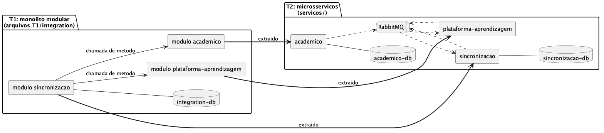

# ADR 0001 – Decomposição: um serviço por módulo de domínio do T1

> **Status:** Aceito
> **Atualizado:** 2026-11-25

## Resumo

O T2 pede que a integração i-Educar → Moodle do T1 vire pelo menos 3 microsserviços, cada um com uma responsabilidade clara e dono dos próprios dados. Decidimos extrair **cada módulo de domínio do monólito do T1 como um serviço**: `academico`, `sincronizacao` e `plataforma-aprendizagem`.

## Motivadores

- Requisito do T2: pelo menos 3 serviços coesos; nenhum serviço acessa o banco de outro; critério justificado em ADR.
- O monólito do T1 (`arquivos T1/integration/`) já era modular e hexagonal, com 3 módulos de domínio e portas definidas.
- O *Resumo das Escolhas Arquiteturais* do T1 previa a extração desses módulos no T2.
- Reaproveitar o código que já funcionava: adaptadores do i-Educar e do Moodle, mapeamentos, regra turma → curso.
- Código simples, fácil de explicar na apresentação individual.

## Opções

### Opção 1: um serviço por módulo de domínio do T1
`academico` (lê o i-Educar), `sincronizacao` (regra, vínculo e estado), `plataforma-aprendizagem` (cria no Moodle).

### Opção 2: dois serviços (leitor do i-Educar + escritor do Moodle)
Um serviço lê o i-Educar e grava o vínculo; outro cria no Moodle.

### Opção 3: um serviço por entidade
Serviços `turma`, `curso` e `vinculo`.

### Opção 4: um serviço por camada técnica
Serviço de API, serviço de lógica e serviço de dados.

## Análise das opções

### Avaliação da opção 1
- Pró: fronteiras pelo domínio (aula de microsserviços: modelagem pelo domínio).
- Pró: alta coesão. Cada serviço muda por um motivo só (API do i-Educar, regra de negócio, API do Moodle).
- Pró: ocultação de informação. Só o `academico` conhece o i-Educar, e só o `plataforma-aprendizagem` conhece o Moodle.
- Pró: reaproveita quase todo o código do T1.
- Contra: mais containers do que as opções 2 e 4.
- Outro: o `plataforma-aprendizagem` fica sem banco, porque o estado dele é o próprio Moodle.

### Avaliação da opção 2
- Pró: menos containers.
- Contra: não atinge o mínimo de 3 serviços.
- Contra: mistura a regra de negócio com um adaptador externo (baixa coesão).

### Avaliação da opção 3
- Contra: a regra "turma vira curso" precisa das três entidades juntas, o que gera muita conversa entre serviços (alto acoplamento).
- Contra: não segue os módulos do T1, então reaproveita menos código.

### Avaliação da opção 4
- Contra: é o anti-exemplo da aula (MusicCorp). Qualquer mudança atravessa todos os serviços.
- Contra: não permite implantação independente na prática.

## Recomendação

**Opção 1.** Cada módulo do T1 virou um serviço em `servicos/`:

| Serviço | Responsabilidade (muda quando...) | Dados |
|---|---|---|
| `academico` | Detectar turmas novas no i-Educar (*...a API do i-Educar muda*) | `academico-db` |
| `sincronizacao` | Regra turma → curso, vínculo, estado e reprocessamento (*...a regra de negócio muda*) | `sincronizacao-db` |
| `plataforma-aprendizagem` | Criar o curso no Moodle sem duplicar (*...a API do Moodle muda*) | nenhum (o estado é o Moodle) |

A opção atende ao mínimo de 3 serviços, segue as fronteiras que o T1 já tinha e mantém cada serviço com um único motivo para mudar. Cada serviço continua hexagonal por dentro e tem sua cópia da pasta `comum/`, em vez de uma biblioteca compartilhada, para ser implantado sozinho.

### Consequências
- Pró: cada serviço com seu banco é um *architecture quantum*, implantado sozinho (`docker compose up -d --build sincronizacao`).
- Pró: a falha de um serviço não derruba os outros (ver [ADR 0002](0002-comunicacao.md)).
- Contra: mais containers e mais memória que o monólito.
- Contra: consistência eventual entre o vínculo e o Moodle.
- Outro: o `plataforma-aprendizagem` sem banco evita estado duplicado; a idempotência usa o `idnumber` do Moodle ([ADR 0003](0003-resiliencia.md)).

### Confirmação
- `docker compose ps` mostra 3 serviços e 2 bancos separados (`academico-db`, `sincronizacao-db`).
- Nenhum serviço tem a URL do banco de outro no `docker-compose.yml`.
- `./testar-integracao.sh` passa: uma turma nova atravessa os 3 serviços e vira curso.

## Mais informações

- Participantes: Juliano Machado da Silva e João Pedro Madruga (consenso do grupo).
- Base: *Resumo das Escolhas Arquiteturais* (`arquivos T1/`), aula *Introdução aos Microsserviços* (29/10) e kickoff do T2 (19/11).
- Comparação completa T1 × T2: [architecture.md](../architecture.md#7-comparação-com-o-t1).
- Reavaliar se surgirem novos fluxos (ex.: matrículas de alunos): podem virar um serviço novo que assina os mesmos eventos.
