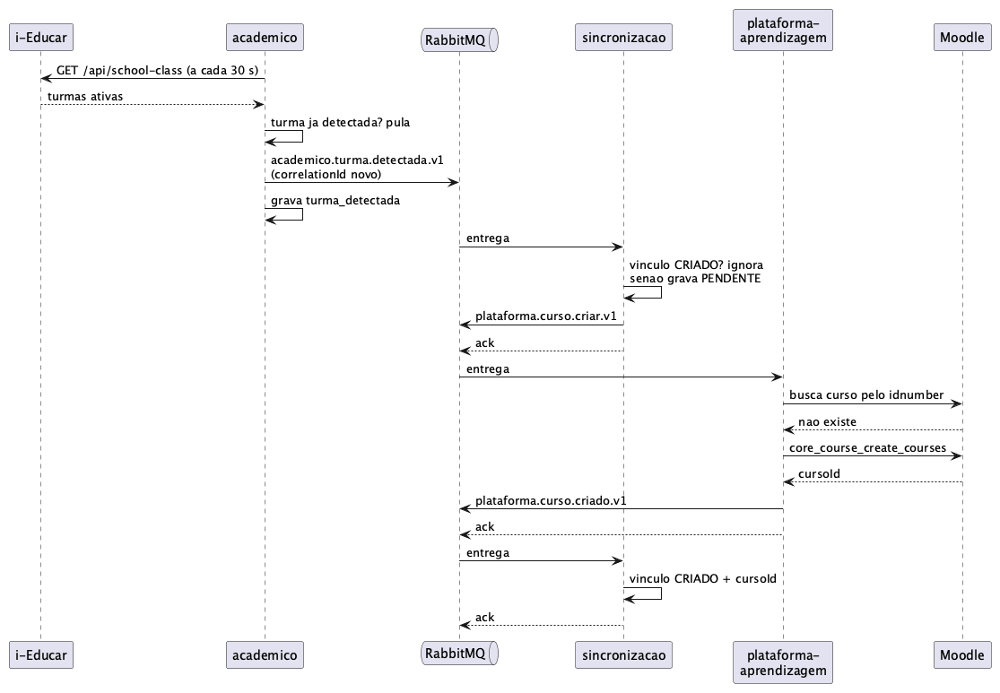

# ADR 0002 – Comunicação: assíncrona entre os serviços, síncrona nas bordas

> **Status:** Aceito
> **Atualizado:** 2026-11-25

## Resumo

Os 3 serviços precisam trocar informações, e o i-Educar e o Moodle só oferecem HTTP. Decidimos que **entre os nossos serviços tudo é assíncrono, por mensagens no RabbitMQ**, com o `sincronizacao` orquestrando o processo. **Nas bordas**, com o i-Educar, o Moodle e os clientes, a comunicação é **síncrona (REST)**, protegida por timeout e retry.

## Motivadores

- Requisito do T2: pelo menos um fluxo por message broker, com eventos de nome, formato e versão documentados; REST ou gRPC onde fizer sentido, justificado.
- Os cenários de falha 2 (Moodle fora) e 4 (serviço reinicia) não podem perder sincronizações.
- O i-Educar e o Moodle não podem ser alterados e só falam HTTP. O i-Educar não avisa quando uma turma é criada.
- O T1 usava chamadas de método: se o Moodle caía, a rodada inteira falhava.

## Opções

### Opção 1: assíncrono entre os serviços (RabbitMQ) + síncrono nas bordas
Eventos e comandos em filas entre os serviços; REST para i-Educar, Moodle e clientes.

### Opção 2: tudo síncrono (REST entre os serviços)
`academico` chama `sincronizacao` por HTTP, que chama `plataforma-aprendizagem` por HTTP.

### Opção 3: assíncrono com Kafka
Mesmo desenho da opção 1, com Kafka no lugar do RabbitMQ.

### Opção 4: gRPC entre os serviços
Chamadas síncronas tipadas com Protocol Buffers.

## Análise das opções

### Avaliação da opção 1
- Pró: desacoplamento no tempo. Se o consumidor ou o Moodle estiver fora, a mensagem espera na fila.
- Pró: o broker já dá fila durável, `ack` manual, reentrega e dead-letter, o que responde aos cenários 2 e 4.
- Pró: baixo acoplamento. O `academico` não sabe quem consome a turma detectada.
- Pró: o NestJS tem transporte RabbitMQ pronto (`@nestjs/microservices`).
- Contra: consistência eventual (vínculo `PENDENTE` por alguns instantes).
- Contra: entrega "pelo menos uma vez", o que exige consumidores idempotentes.
- Outro: depurar exige correlation ID e tracing.

### Avaliação da opção 2
- Pró: mais simples de entender e depurar.
- Contra: acoplamento temporal. Se o `plataforma-aprendizagem` ou o Moodle cair, a cadeia inteira falha.
- Contra: retry, reentrega e DLQ teriam de ser escritos à mão.
- Contra: não atende ao requisito de usar um broker.

### Avaliação da opção 3
- Pró: ótimo para alto volume e para reler o histórico de eventos.
- Contra: não tem DLQ nativa nem contagem de tentativas por mensagem.
- Contra: mais pesado para rodar junto com i-Educar e Moodle num notebook.
- Outro: o problema é "faça este trabalho uma vez com segurança", e não "guarde um log de eventos".

### Avaliação da opção 4
- Contra: continua síncrono (mesmos problemas da opção 2).
- Contra: o i-Educar e o Moodle não falam gRPC; seria tecnologia a mais sem problema a resolver.

## Recomendação

**Opção 1, com RabbitMQ.**

| De → para | Mensagem | Fila | Tipo |
|---|---|---|---|
| academico → sincronizacao | `academico.turma.detectada.v1` | `turmas` | Evento (fato) |
| sincronizacao → plataforma-aprendizagem | `plataforma.curso.criar.v1` | `cursos` | Comando (pedido) |
| plataforma-aprendizagem → sincronizacao | `plataforma.curso.criado.v1` / `.falhou.v1` | `resultados` | Evento (resultado) |
| academico → i-Educar | `GET /api/school-class` a cada 30 s (polling) | — | Síncrono |
| plataforma-aprendizagem → Moodle | Web Services REST | — | Síncrono |
| Cliente → gateway → serviços | REST | — | Síncrono |

- **Orquestração:** o `sincronizacao` guarda o estado de cada turma e decide o próximo passo. Com coreografia pura, a regra ficaria espalhada pelos serviços.
- **Polling no i-Educar:** ele não emite eventos e não pode ser alterado (mesma decisão do T1).
- **Formato e versão:** envelope único e catálogo em [architecture.md](../architecture.md#3-catálogo-de-eventos).

### Consequências
- Pró: a queda de um serviço ou do Moodle não perde nem trava nada.
- Pró: um serviço novo pode assinar os mesmos eventos sem mudar quem publica.
- Contra: consistência eventual, aceita porque criar o curso alguns instantes depois não afeta o usuário.
- Contra: todo consumidor precisa ser idempotente ([ADR 0003](0003-resiliencia.md)).
- Outro: correlation ID no envelope e tracing com OpenTelemetry para seguir uma sincronização ([ADR 0004](0004-stack.md)).

### Confirmação
- Cenário 2b (25/11): com o Moodle parado, a mensagem esperou e o curso foi criado sozinho quando ele voltou.
- Cenário 4 (25/11): com o serviço morto, a mensagem voltou de *unacked* para *ready* e foi processada uma vez.
- Os logs dos 3 serviços mostram o mesmo `correlationId`; o Jaeger mostra um trace que atravessa o RabbitMQ.

## Mais informações

- Participantes: Juliano Machado da Silva e João Pedro Madruga (consenso do grupo).
- Base: kickoff do T2 (requisito de broker) e Resumo do T1 (citava RabbitMQ ou Kafka para a etapa 2).
- Reavaliar se o i-Educar passar a emitir eventos (o polling poderia ser trocado) ou se o volume crescer a ponto de justificar Kafka.
