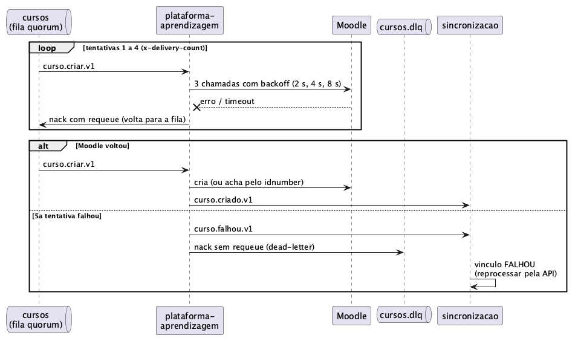

# ADR 0003 – Resiliência: idempotência, retry com backoff, DLQ e circuit breaker

> **Status:** Aceito
> **Atualizado:** 2026-11-25

## Resumo

Com mensagens entregues "pelo menos uma vez" e sistemas externos que podem cair, a integração não pode duplicar cursos nem travar. Decidimos usar o que o framework e o RabbitMQ já oferecem:
- consumidores idempotentes (com **busca pelo `idnumber` no Moodle antes de criar**);
- `ack` manual;
- timeout e retry com backoff;
- até 5 entregas e depois DLQ;
- circuit breaker no i-Educar.

## Motivadores

- Requisitos do T2: consumidores idempotentes; timeout e retry com backoff nas chamadas ao i-Educar e ao Moodle; DLQ sem bloquear o fluxo; circuit breaker desejável.
- Os 4 cenários de falha: i-Educar fora, Moodle fora, resposta perdida e serviço que reinicia.
- Código simples: preferir o que o NestJS e o RabbitMQ já têm.

## Opções

### Opção 1: mecanismos nativos + idempotência pelo estado e pelo `idnumber`
`HttpModule` (timeout), `retry` do RxJS (backoff), `ack`/`nack` do transporte RMQ do Nest, fila quorum (contagem de entregas e dead-letter), `opossum` (circuit breaker), vínculo com estados e busca pelo `idnumber`.

### Opção 2: outbox transacional + tabela de mensagens processadas
Gravar o evento na mesma transação do dado e publicar por um processo separado; registrar o id de cada mensagem consumida.

### Opção 3: biblioteca de resiliência completa (`cockatiel`) + filas de retry com TTL
Política única de retry, timeout e circuit breaker; filas `.retry` com tempo de espera que devolvem à fila principal.

### Opção 4: service mesh
Timeout, retry e circuit breaker configurados num proxy ao lado de cada serviço.

## Análise das opções

### Avaliação da opção 1
- Pró: pouco código nosso; quase tudo vem do framework e do broker.
- Pró: o `idnumber` resolve o cenário 3 (resposta perdida), que nenhum mecanismo de fila resolveria.
- Contra: sem outbox, existe uma janela entre publicar e gravar, coberta pela idempotência.
- Outro: as novas entregas são imediatas (sem espera entre elas); a espera vem do backoff dentro de cada tentativa.

### Avaliação da opção 2
- Pró: elimina a janela entre gravar e publicar.
- Contra: mais tabelas, um processo de publicação e mais código para explicar.
- Contra: com consumidores idempotentes, o ganho prático aqui é pequeno.

### Avaliação da opção 3
- Pró: espera configurável entre as entregas.
- Contra: mais topologia (exchanges, filas `.retry`, TTL) e mais uma biblioteca.
- Outro: o RxJS já faz retry com backoff.

### Avaliação da opção 4
- Contra: a malha não cobre a comunicação pelo broker e só se justifica com muitos serviços ([ADR 0005](0005-api-gateway.md)).

## Recomendação

**Opção 1.**

| Mecanismo | Onde | Como |
|---|---|---|
| Idempotência | academico | Tabela `turma_detectada`: a mesma turma não é publicada duas vezes |
| | sincronizacao | Vínculo com chave por turma: `CRIADO` ignora turma repetida |
| | plataforma-aprendizagem | Busca o curso pelo `idnumber` (`ieducar-turma-<id>`) antes de criar; se existe, usa o mesmo (`jaExistia: true`) |
| `ack` manual | consumidores | Só confirma depois de processar |
| Timeout | adaptadores HTTP | 5 s (i-Educar), 10 s (Moodle) |
| Retry com backoff | adaptadores HTTP | 1/2/4 s (i-Educar), 2/4/8 s (Moodle) |
| Novas entregas + DLQ | plataforma-aprendizagem | `nack` com requeue; na 5ª entrega (`x-delivery-count`) publica `curso.falhou.v1` e manda para a `cursos.dlq` |
| Reprocessamento | sincronizacao | `POST /vinculos/:turmaId/reprocessar` |
| Circuit breaker | academico → i-Educar | `opossum`: abre com 3 falhas em 2 min e testa de novo depois de 30 s; estado no `/health` |

**Entrega "pelo menos uma vez" + consumidor idempotente = efeito "exatamente uma vez".**

- **Por que sem outbox:**
  - O `academico` publica e depois grava. Se cair no meio, publica de novo no próximo ciclo, e o `sincronizacao` ignora a repetida.
  - O `sincronizacao` grava `PENDENTE` e depois publica. Se cair no meio, a mensagem que ele consumia volta (não houve `ack`) e o pedido é refeito.
- **Por que circuit breaker só no i-Educar:**
  - No `academico`, o circuito aberto só pula ciclos de polling.
  - No `plataforma-aprendizagem`, ele faria as mensagens queimarem as 5 entregas em segundos e irem para a DLQ antes de o Moodle voltar. Lá, o backoff (~15 s por entrega, ~75 s no total) segura melhor uma queda curta.

### Consequências
- Pró: nenhum curso duplicado em nenhum cenário testado.
- Pró: uma mensagem que falha sempre não trava a fila; vai para a DLQ e pode ser reprocessada.
- Contra: uma queda do Moodle maior que ~75 s leva as turmas pendentes para `FALHOU`, e é preciso reprocessar pela API.
- Contra: o código de resiliência se repete em cada serviço (aceitável com 3).
- Outro: a fila tem `x-delivery-limit: 20` como proteção extra contra loop.

### Confirmação
Os 4 cenários foram reproduzidos em 25/11 ([failure-scenarios.md](../failure-scenarios.md)). Dois ajustes saíram dos testes:
- **Janela do circuit breaker:** passou de 10 s para 2 min. Cada chamada falha em ~7 s por causa do retry, e na janela de 10 s nunca cabiam 3 falhas.
- **Métrica `sincronizacao_duracao_segundos`:** passou a medir a partir do último `PENDENTE`.

O `/metrics` (`falhas_total`, `mensagens_processadas_total{resultado="dlq"}`) mostra as falhas em execução.

## Mais informações

- Participantes: Juliano Machado da Silva e João Pedro Madruga (consenso do grupo).
- Base: aula *API Gateway e Service Mesh* (circuit breaker, retry, timeout) e kickoff do T2.
- Reavaliar o outbox e uma espera entre as entregas se o volume crescer ou se quedas longas do Moodle forem comuns.
