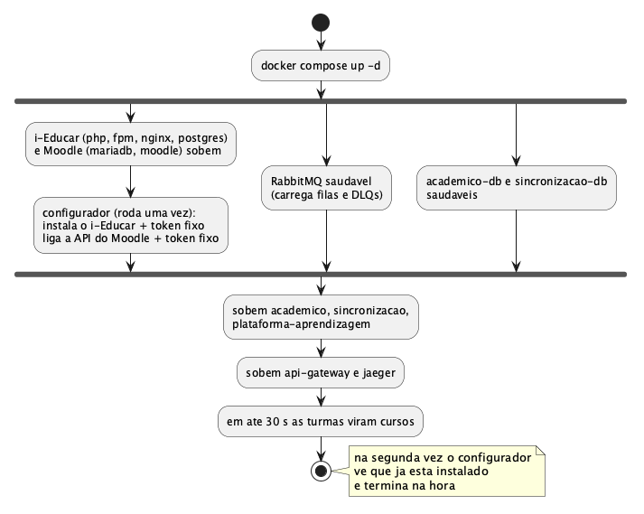

# ADR 0004 – Stack

> **Status:** Aceito
> **Atualizado:** 2026-11-25

## Resumo

A stack é livre, desde que justificada, e tudo precisa subir com um único `docker compose up` em qualquer máquina. Decidimos manter a base do T1 (**NestJS + TypeScript + PostgreSQL**) e acrescentar **RabbitMQ**, **OpenTelemetry + Jaeger** e **nginx**. Os serviços foram gerados com o próprio CLI do NestJS, e usamos o máximo do que o framework oferece.

## Motivadores

- Requisito do T2: stack justificada; um único `docker compose up` sobe serviços, broker, bancos, i-Educar e Moodle.
- Continuidade com o T1 e com o *Resumo das Escolhas Arquiteturais*.
- Código simples, de preferência gerado pela ferramenta.
- Observabilidade exigida: logs com correlation ID, health checks, métricas; tracing desejável.

## Opções

### Opção 1: NestJS 12 + RabbitMQ + PostgreSQL + bibliotecas do ecossistema Nest
`nest new` / `nest g`, `@nestjs/microservices` (RMQ), TypeORM, `@nestjs/terminus`, `prom-client`, `ConsoleLogger` em JSON, OpenTelemetry sem código, nginx, container `configurador`.

### Opção 2: NestJS com adaptadores e infraestrutura escritos à mão
`amqplib` direto, `nestjs-pino`, `cockatiel`, Prometheus + Grafana.

### Opção 3: outra linguagem ou framework (ex.: Spring Boot, Go)
Reescrever os serviços numa stack diferente da do T1.

## Análise das opções

### Avaliação da opção 1
- Pró: reaproveita o código e o conhecimento do T1.
- Pró: transporte RabbitMQ, health check, HTTP e agendamento já prontos no framework.
- Pró: tracing apenas com variáveis de ambiente.
- Contra: o NestJS 12 gera projetos ESM (imports relativos com `.js`).

### Avaliação da opção 2
- Pró: mais controle sobre o broker e os logs.
- Contra: mais código para escrever, testar e explicar.
- Contra: Grafana e Prometheus somam containers sem ser exigidos.

### Avaliação da opção 3
- Contra: descarta o código do T1 e o Resumo de arquitetura.
- Contra: curva de aprendizado com prazo curto.

## Recomendação

**Opção 1.**

| Peça | Escolha |
|---|---|
| Serviços | NestJS 12 + TypeScript, gerados com `nest new` e `nest g` |
| Mensageria | RabbitMQ 4.1 + `@nestjs/microservices` (`ClientProxy.emit` / `@EventPattern`) |
| Banco | PostgreSQL 17, um container por serviço com estado; TypeORM com `synchronize` |
| Resiliência | `HttpModule` (timeout), RxJS `retry` (backoff), `opossum` (circuit breaker) |
| Health check | `@nestjs/terminus` (`/health`) |
| Métricas | `prom-client` (`/metrics`) |
| Logs | `ConsoleLogger({ json: true })` do Nest |
| Tracing | OpenTelemetry auto-instrumentação (`NODE_OPTIONS=--import @opentelemetry/auto-instrumentations-node/register`) + Jaeger |
| Gateway | nginx ([ADR 0005](0005-api-gateway.md)) |
| Subida | Docker Compose + container `configurador` (`docker:29-cli`), que repete os passos do `instalar.sh` do T1 com `docker exec` |

Os tokens do i-Educar e do Moodle são fixos no `docker-compose.yml`. Por ser um trabalho acadêmico para rodar em qualquer máquina, isso dispensa `.env` e passos manuais.

### Consequências
- Pró: um comando, sem `.env` e sem passos manuais.
- Pró: pouco código nosso; a maior parte é gerada ou vem do framework.
- Contra: o `configurador` usa o `docker.sock` para rodar comandos nos containers do i-Educar e do Moodle (aceitável em ambiente local).
- Contra: o compose do i-Educar usa nomes fixos de container, então o T1 e o T2 não rodam ao mesmo tempo na mesma máquina.
- Outro: primeira subida de alguns minutos (build e instalação do Moodle); as seguintes levam segundos.

### Confirmação
- `docker compose up -d` com volumes novos sobe tudo, e o `configurador` termina com código 0 (testado em 23/11).
- Os 3 serviços ficam `healthy` no `docker compose ps`.
- Pendente: teste de clone limpo em outra máquina.

## Mais informações

- Participantes: Juliano Machado da Silva e João Pedro Madruga (consenso do grupo).
- Base: *Resumo das Escolhas Arquiteturais* do T1 (NestJS + TypeScript + PostgreSQL) e kickoff do T2.
- Reavaliar o `configurador` se o i-Educar oferecer uma imagem já instalada.
