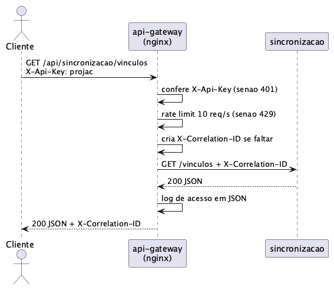

# ADR 0005 – API Gateway com nginx, sem service mesh (ponto extra)

> **Status:** Aceito
> **Atualizado:** 2026-11-25

## Resumo

Os 3 serviços expõem HTTP (consultas, disparo manual, health e métricas). Decidimos colocar um **API Gateway nginx** como entrada única para o tráfego de fora (norte-sul), só com funções de borda: roteamento, chave de API, rate limit, correlation ID e log. Decidimos **não** usar service mesh.

## Motivadores

- Sem gateway, o cliente precisaria conhecer cada serviço e cada porta, e cada serviço repetiria autenticação e limites.
- Aula *API Gateway e Service Mesh* (12/11): gateway para o tráfego norte-sul; malha para o leste-oeste.
- Ponto extra no T2.
- Código simples: nada de regra de negócio no gateway.

## Opções

### Opção 1: nginx só com configuração
Um container nginx com `infra/gateway/nginx.conf`.

### Opção 2: gateway escrito em NestJS
Mais um serviço que repassa as requisições.

### Opção 3: produto de API management (ex.: Kong)
Gateway com plugins, painel e banco próprio.

### Opção 4: sem gateway
Cada serviço publica sua porta.

### Opção 5: service mesh (ex.: Istio, Linkerd)
Sidecar ao lado de cada serviço para o tráfego entre eles.

## Análise das opções

### Avaliação da opção 1
- Pró: roteamento, limite de requisições, cabeçalhos e log só com configuração, sem código nosso.
- Pró: imagem leve e conhecida.
- Contra: lógica mais complexa (ex.: validar JWT) exigiria módulos extras.

### Avaliação da opção 2
- Contra: mais um serviço com código para manter, sem ganho.

### Avaliação da opção 3
- Contra: recursos de "economia de APIs" que não usamos; o slide recomenda um produto focado na necessidade real.
- Contra: mais containers (e um banco próprio).

### Avaliação da opção 4
- Contra: o cliente conhece a decomposição interna; autenticação e limites repetidos em cada serviço.

### Avaliação da opção 5
- Contra: o slide diz que a malha *"raramente se justifica com poucos serviços"* e vale a pena com muitos serviços, várias linguagens e Kubernetes. Aqui são 3 serviços, uma linguagem e Docker Compose.
- Contra: a comunicação entre os nossos serviços é pelo broker, que *"normalmente não passa pela malha"*.

## Recomendação

**Opção 1 (nginx), sem service mesh.** O container `api-gateway` ocupa a porta 8000, e os 3 serviços não publicam porta para fora.

| Função de borda | Como |
|---|---|
| Roteamento | `/api/academico/*`, `/api/sincronizacao/*`, `/api/plataforma/*` |
| Autenticação | `X-Api-Key: projac`; sem ela devolve `401` |
| Rate limiting | 10 req/s por IP, rajada de 20; acima disso devolve `429` |
| Correlation ID | Repassa o `X-Correlation-ID` ou cria um, e devolve na resposta |
| Log | Acesso em JSON com o correlation ID |
| Tradução de protocolo | REST para fora; dentro, o fluxo segue por AMQP |

- **De propósito, o gateway não tem regra de negócio nem composição** ("pontas inteligentes, canos burros"). O estado consolidado de cada turma é do `sincronizacao`.
- **Sem BFF:** só existe um tipo de cliente.
- **Sem malha:** timeout, retry, circuit breaker e correlation ID ficam no código ([ADR 0003](0003-resiliencia.md)), e o tracing vem do OpenTelemetry.

### Consequências
- Pró: o cliente conhece um endereço só. Se um serviço for dividido, só o `nginx.conf` muda.
- Pró: autenticação e limites num lugar só.
- Contra: mais um componente no caminho. Se o gateway cair, a API de consulta cai, mas a sincronização por mensagens continua.
- Outro: a chave de API é fixa (aceitável no trabalho; em produção viria de um cofre de segredos).

### Confirmação
Testado em 25/11:
- requisição sem chave → `401`;
- 100 requisições, 25 em paralelo → 23 × `200` e 77 × `429`;
- `X-Correlation-ID` presente na resposta e nos logs dos serviços.

## Mais informações

- Participantes: Juliano Machado da Silva e João Pedro Madruga (consenso do grupo).
- Base: aula *API Gateway e Service Mesh* (12/11), incluindo a atividade "onde fica cada responsabilidade".
- Reavaliar a malha se o número de serviços crescer muito, ou com várias linguagens e Kubernetes.
