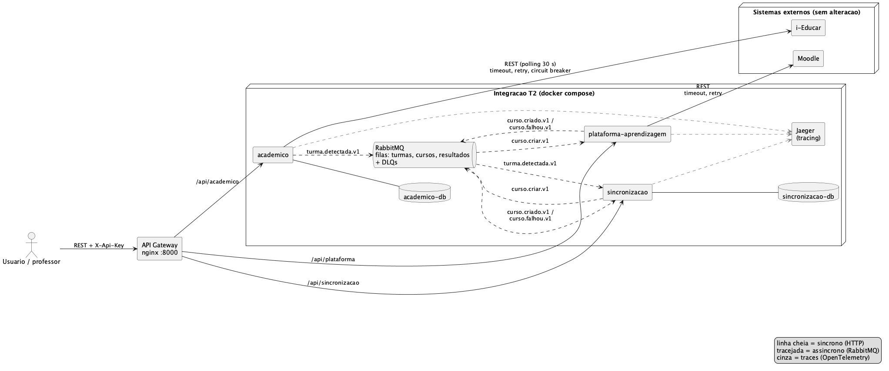
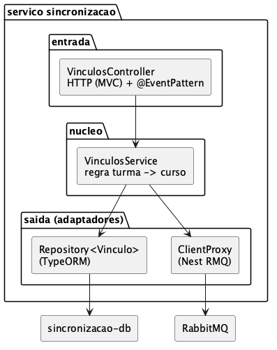
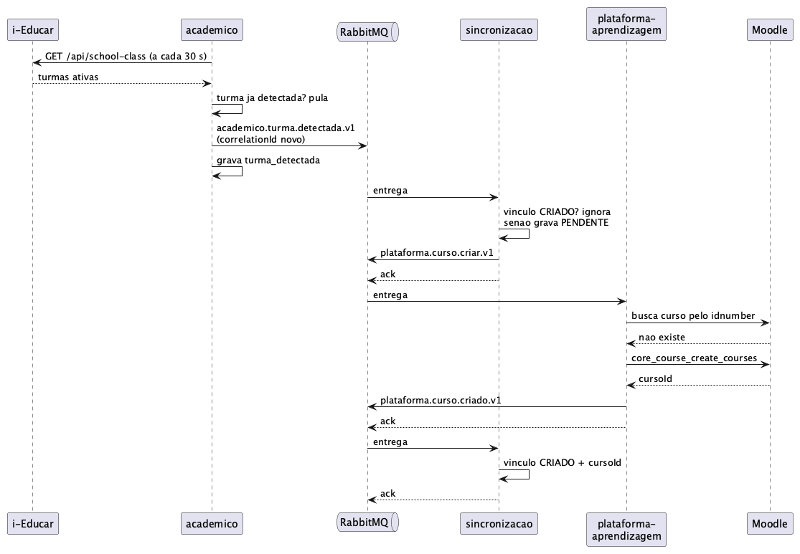
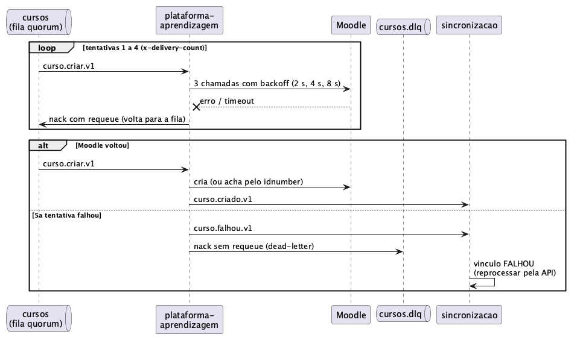
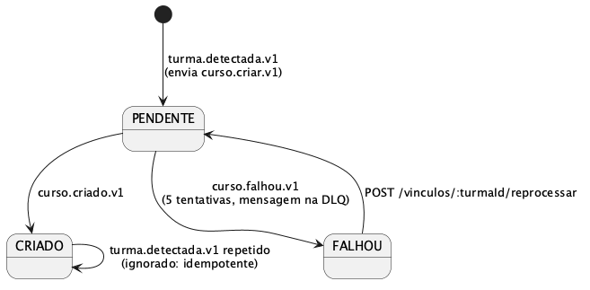
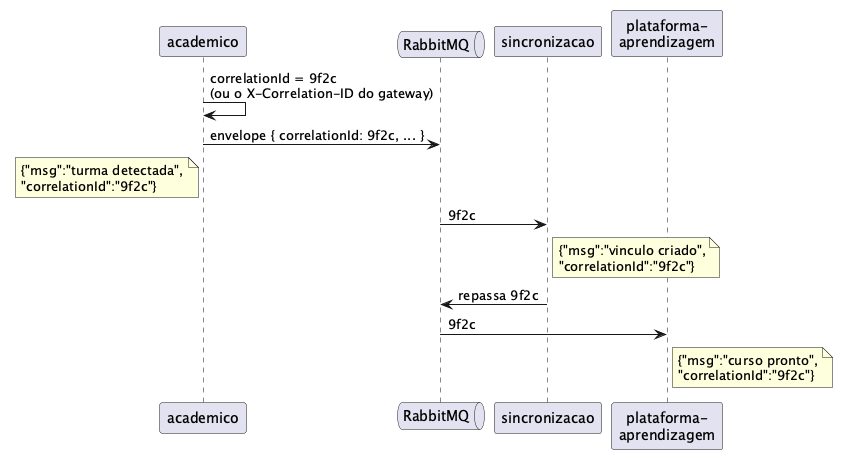
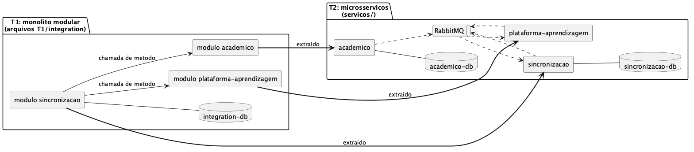

# Arquitetura do T2

**Autores:** Juliano Machado da Silva e João Pedro Madruga

## 1. Visão geral

O T2 reprojeta a integração do T1 (turma ativa do i-Educar → curso no Moodle) como **3 microsserviços** que conversam por **mensagens no RabbitMQ**. Os sistemas externos ficam nas bordas e são acessados por HTTP. Um **API Gateway** é a única entrada para quem está fora.



| Componente | Responsabilidade | Dados próprios |
|---|---|---|
| **academico** | Detectar turmas novas no i-Educar (polling a cada 30 s ou `POST /deteccoes`) e publicar `academico.turma.detectada.v1` | `academico-db`: tabela `turma_detectada` |
| **sincronizacao** | Orquestrar a sincronização: decidir se a turma precisa de curso, guardar o vínculo turma↔curso e o estado (`PENDENTE`/`CRIADO`/`FALHOU`), permitir reprocessar | `sincronizacao-db`: tabela `vinculo_turma_curso` |
| **plataforma-aprendizagem** | Criar o curso no Moodle sem duplicar (busca pelo `idnumber` antes de criar) | nenhum: o estado dele é o próprio Moodle |
| **RabbitMQ** | Filas duráveis `turmas`, `cursos`, `resultados` e as DLQs | volume `rabbitmq_data` |
| **api-gateway** (nginx) | Entrada única: roteamento, chave de API, rate limit, correlation ID, log | — |
| **jaeger** | Recebe os traces (OpenTelemetry) dos 3 serviços | — |
| **configurador** | Roda uma vez na subida: instala o i-Educar e liga a API do Moodle | — |

Nenhum serviço lê o banco de outro: os dados viajam só nos eventos e nas APIs.

### Por dentro de cada serviço

Cada serviço continua **hexagonal**, como o monólito do T1 (ver *Resumo das Escolhas Arquiteturais* em `arquivos T1/`):
- os controllers (HTTP e `@EventPattern`) são a entrada;
- os services têm a regra;
- o TypeORM, o cliente do RabbitMQ e os adaptadores do i-Educar e do Moodle são a saída.

Os adaptadores externos fazem a **ACL**: só eles conhecem os nomes de campo do i-Educar (`cod_turma`, `nm_turma`...) e da API do Moodle (`courses[0][fullname]`...).



## 2. Comunicação

| Trecho | Tipo | Por quê |
|---|---|---|
| academico → sincronizacao | **Assíncrono** (evento) | O `academico` não precisa saber quem usa a informação nem esperar. Se o consumidor cair, o evento espera na fila. |
| sincronizacao → plataforma-aprendizagem | **Assíncrono** (comando) | Criar curso depende do Moodle, que pode estar lento ou fora. A fila dá retry, DLQ e reentrega. |
| plataforma-aprendizagem → sincronizacao | **Assíncrono** (evento) | O resultado volta sem que o `sincronizacao` fique bloqueado esperando. |
| academico → i-Educar | Síncrono (REST, polling) | É a única interface do i-Educar, que não avisa quando uma turma é criada. |
| plataforma-aprendizagem → Moodle | Síncrono (REST) | É a única interface do Moodle. |
| Cliente → gateway → serviços | Síncrono (REST) | Consultas e disparos curtos, em que se quer a resposta na hora. |

**Regra:** mensagens entre os nossos serviços, HTTP nas bordas. Justificativa completa no [ADR 0002](adr/0002-comunicacao.md).



## 3. Catálogo de eventos

### 3.1 Envelope (igual para todos)

```json
{
  "id": "6f1c2b9e-...",
  "tipo": "academico.turma.detectada",
  "versao": 1,
  "ocorridoEm": "2026-11-25T13:00:00.000Z",
  "correlationId": "9f2c...",
  "dados": { }
}
```

| Campo | Significado |
|---|---|
| `id` | UUID único da mensagem |
| `tipo` | Nome do evento, sem a versão |
| `versao` | Versão do formato de `dados` |
| `ocorridoEm` | Data e hora em ISO 8601 (UTC) |
| `correlationId` | Acompanha a sincronização por todos os serviços (vem do gateway ou é criado pelo `academico`) |
| `dados` | Conteúdo do evento (tabela abaixo) |

No RabbitMQ, o transporte do NestJS envia `{ "pattern": "<nome>.v<versao>", "data": <envelope> }`. O `pattern` é o que o consumidor assina com `@EventPattern`.

### 3.2 Eventos

| Nome (`pattern`) | Tipo | Fila | Produtor | Consumidor | `dados` |
|---|---|---|---|---|---|
| `academico.turma.detectada.v1` | Evento | `turmas` | academico | sincronizacao | `{ id, nome, ano, escolaId }` |
| `plataforma.curso.criar.v1` | Comando | `cursos` | sincronizacao | plataforma-aprendizagem | `{ turmaId, nomeCompleto, nomeCurto, codigoExterno }` |
| `plataforma.curso.criado.v1` | Evento | `resultados` | plataforma-aprendizagem | sincronizacao | `{ turmaId, cursoId, jaExistia }` |
| `plataforma.curso.falhou.v1` | Evento | `resultados` | plataforma-aprendizagem | sincronizacao | `{ turmaId, erro, tentativas }` |

Exemplo de `plataforma.curso.criar.v1`:

```json
{
  "id": "0b7e...", "tipo": "plataforma.curso.criar", "versao": 1,
  "ocorridoEm": "2026-11-25T13:00:00.100Z", "correlationId": "9f2c...",
  "dados": { "turmaId": 42, "nomeCompleto": "2º ano Integral", "nomeCurto": "turma-42", "codigoExterno": "ieducar-turma-42" }
}
```

### 3.3 Versionamento

- A versão está no nome (`.v1`) e no campo `versao`.
- **Campo novo opcional** não muda a versão: os consumidores ignoram campos que não conhecem.
- **Mudança incompatível** (renomear ou remover campo, mudar o tipo) gera `.v2`, publicada junto com a `.v1` até todos os consumidores migrarem.

## 4. Filas e dead-letter

Declaradas em `infra/rabbitmq/definitions.json` e carregadas quando o RabbitMQ sobe.

| Fila | Tipo | Consumidor | DLQ |
|---|---|---|---|
| `turmas` | quorum, durável | sincronizacao | `turmas.dlq` |
| `cursos` | quorum, durável | plataforma-aprendizagem | `cursos.dlq` |
| `resultados` | quorum, durável | sincronizacao | `resultados.dlq` |

- **Mensagens persistentes:** sobrevivem a reinício do RabbitMQ.
- **`ack` manual** (`noAck: false`, `prefetchCount: 1`): a mensagem só sai da fila depois de processada.
- **Contagem de tentativas:** a fila quorum conta as entregas no cabeçalho `x-delivery-count`.
  - O `plataforma-aprendizagem` tenta **5 vezes**. Na 5ª falha, publica `curso.falhou.v1` e rejeita sem requeue, e a mensagem vai para a DLQ.
  - Proteção extra: `x-delivery-limit: 20` em todas as filas.



## 5. Estado da sincronização



O vínculo é a "fonte da verdade" do processo:
- `PENDENTE`: o curso foi pedido e ainda não há resposta.
- `CRIADO`: o curso existe, com o `cursoId` do Moodle.
- `FALHOU`: esgotou as tentativas. `POST /vinculos/:turmaId/reprocessar` tenta de novo.

Isso é **consistência eventual**: por alguns instantes a turma existe no i-Educar e o curso ainda não existe no Moodle. Nos testes, a sincronização levou ~0,1 s quando os dois sistemas estavam no ar.

## 6. Resiliência e observabilidade (resumo)

| Item | Implementação |
|---|---|
| Idempotência | `turma_detectada` (academico), vínculo com chave por turma (sincronizacao), busca pelo `idnumber` antes de criar (plataforma) |
| Timeout | `HttpModule`: 5 s no i-Educar, 10 s no Moodle |
| Retry com backoff | `retry` do RxJS: 1/2/4 s no i-Educar, 2/4/8 s no Moodle |
| Circuit breaker | `opossum` no i-Educar: abre com 3 falhas em 2 min e testa de novo em 30 s |
| DLQ | `*.dlq` depois de 5 tentativas |
| Logs | JSON (`ConsoleLogger({ json: true })`) com `correlationId` e `turmaId` |
| Health check | `GET /health` (`@nestjs/terminus`): banco, RabbitMQ e estado do circuit breaker. Usado pelo `HEALTHCHECK` do Docker. |
| Métricas | `GET /metrics` (`prom-client`): `mensagens_processadas_total`, `falhas_total`, `sincronizacao_duracao_segundos` |
| Tracing | OpenTelemetry sem código (`--import @opentelemetry/auto-instrumentations-node/register`) → Jaeger. O trace atravessa o RabbitMQ. |



Detalhes em [ADR 0003](adr/0003-resiliencia.md) e em [failure-scenarios.md](failure-scenarios.md).

## 7. Comparação com o T1

O monólito do T1 continua no repositório, desativado, em `arquivos T1/integration/`. Cada módulo dele foi extraído para um serviço:



| Módulo do T1 (`arquivos T1/integration/src/`) | Serviço do T2 (`servicos/`) | Reaproveitado |
|---|---|---|
| `academico/` | `academico` | Adaptador do i-Educar (com paginação) e mapeamento para `Turma` |
| `sincronizacao/` | `sincronizacao` | Regra turma → curso (`nomeCurto = turma-<id>`, `idnumber = ieducar-turma-<id>`) e a tabela de vínculo |
| `plataforma-aprendizagem/` | `plataforma-aprendizagem` | Adaptador do Moodle e mapeamento de `Curso` |

| Aspecto | T1 | T2 |
|---|---|---|
| Estilo | Monólito modular hexagonal | Microsserviços hexagonais |
| Unidades de implantação | 1 (`integration`) | 3 serviços + gateway |
| Bancos da integração | 1 (`integration-db`) | 2 (`academico-db`, `sincronizacao-db`) + 1 serviço sem estado |
| Comunicação entre módulos | Chamada de método | Eventos e comandos no RabbitMQ |
| Disparo | `@Cron` a cada minuto + `POST /sincronizacao/turmas` | `@Cron` a cada 30 s + `POST /api/academico/deteccoes` pelo gateway |
| Idempotência | Consulta o vínculo antes de criar | Vínculo + `turma_detectada` + busca pelo `idnumber` no Moodle |
| Moodle fora do ar | A turma entra na lista de falhas e é tentada no próximo minuto | Retry com backoff, até 5 entregas, DLQ, estado `FALHOU` e reprocessamento |
| Resposta perdida do Moodle | O Moodle recusa o `idnumber` repetido, mas o vínculo nunca é gravado (a turma falha para sempre) | Acha o curso existente pelo `idnumber` e grava o vínculo |
| Serviço cai no meio | A execução daquele minuto se perde; a próxima recomeça | Mensagem não confirmada volta para a fila |
| Observabilidade | Logs de texto e tabela de histórico | Logs JSON com correlation ID, health checks, métricas e tracing |
| Consistência | Imediata (tudo no mesmo processo) | Eventual (`PENDENTE` → `CRIADO`) |
| Entrada | Porta 3000 do serviço | API Gateway na porta 8000, com chave e rate limit |
| Subida | `./instalar.sh` (gera tokens no `.env`) | `docker compose up -d` (configurador + tokens fixos) |

**Trade-off:** o T2 ganhou isolamento de falhas, reprocessamento e rastreabilidade. Em troca, pagou com mais containers, consistência eventual e mais configuração de infraestrutura. Para o volume real (dezenas de turmas), o monólito do T1 seria suficiente. O T2 mostra como a mesma regra evolui quando tolerância a falhas e implantação independente passam a importar.
