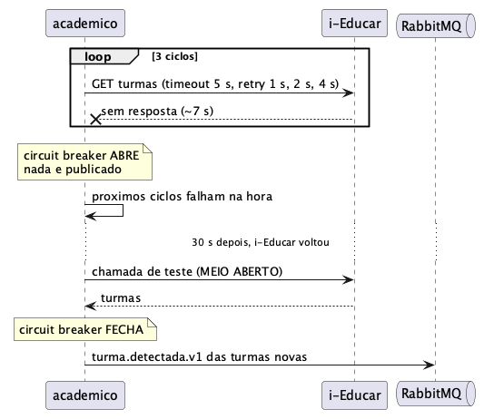
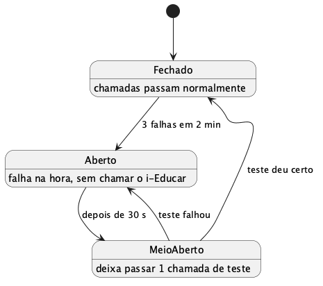
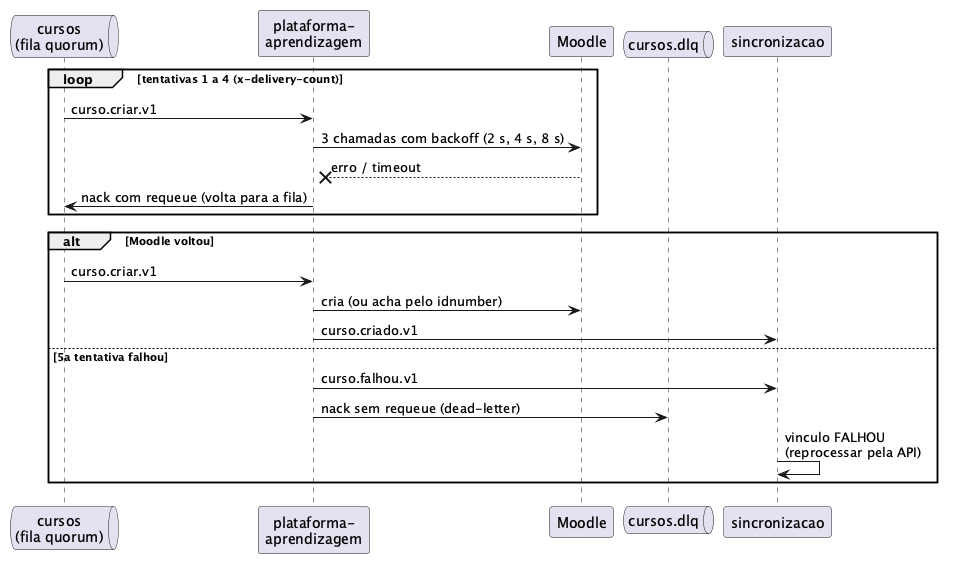
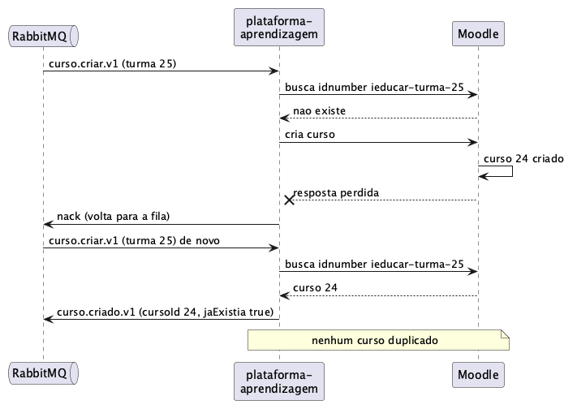
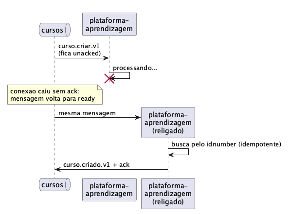

# Cenários de falha

**Autores:** Juliano Machado da Silva e João Pedro Madruga

Os quatro cenários pedidos no T2, com o que acontece na arquitetura, como reproduzir e o que observar. Todos foram testados em **25/11/2026**, e os resultados abaixo são os observados.

**Antes de começar:**
- ambiente no ar (`docker compose up -d`, serviços `healthy`);
- dois terminais na raiz do projeto:
  - **terminal 1:** `docker compose logs -f academico sincronizacao plataforma-aprendizagem`;
  - **terminal 2:** para os comandos.
- Painel das filas: http://localhost:15672 (`projac` / `projac`) → aba *Queues*.

Atalhos usados abaixo:

```bash
API=http://localhost:8000/api
K="X-Api-Key: projac"
```

| # | Cenário | Mecanismo que responde | Resultado no teste |
|---|---|---|---|
| 1 | i-Educar fora do ar | Timeout + retry com backoff + **circuit breaker** | Nada publicado; circuito abre e fecha sozinho quando ele volta |
| 2 | Moodle fora do ar | Retry com backoff + **novas entregas** + **DLQ** + reprocessamento | Recupera sozinho se o Moodle volta a tempo; senão `FALHOU` e reprocessa |
| 3 | Moodle cria o curso, mas a resposta não chega | **Busca pelo `idnumber`** antes de criar | 1 curso só (`jaExistia: true`) |
| 4 | Serviço reinicia no meio | **`ack` manual** + idempotência | Mensagem volta para a fila e é processada uma vez |

---

## Cenário 1: i-Educar fora do ar



**O que acontece:**
- O `academico` tenta ler o i-Educar com timeout de 5 s e 3 retries (1 s, 2 s, 4 s), ~7 s por ciclo.
- Nada é publicado, e os outros serviços seguem normais.
- Depois de 3 falhas em 2 minutos, o **circuit breaker abre**: os ciclos seguintes falham na hora, sem chamar o i-Educar.
- 30 s depois, ele deixa passar uma chamada de teste (**meio aberto**). Se der certo, **fecha**, e as turmas que faltavam são publicadas.



**Como reproduzir:**

```bash
docker compose stop nginx                                   # nginx = servidor web do i-Educar
for i in 1 2 3 4 5; do curl -s -X POST -H "$K" $API/academico/deteccoes; echo; done
curl -s -H "$K" $API/academico/health                       # "circuitBreaker":"aberto"
docker compose start nginx
sleep 40
curl -s -X POST -H "$K" $API/academico/deteccoes            # volta a responder com as turmas
curl -s -H "$K" $API/academico/health                       # "circuitBreaker":"fechado"
```

**Resultado observado:**
- As 3 primeiras chamadas falharam em ~7 s cada (`{"erro":"i-Educar indisponivel"}`). As seguintes falharam na hora: circuito aberto.
- Os logs do `academico` mostraram, em ordem:
  - `circuit breaker ABERTO: i-Educar fora do ar`
  - `circuit breaker MEIO ABERTO: testando o i-Educar`
  - `circuit breaker FECHADO: i-Educar voltou`
- O `/health` continua `status: ok` durante a queda: o serviço está vivo e se recupera sozinho, e o estado do circuito aparece no detalhe.
- `/metrics` → `falhas_total{origem="ieducar"}` aumenta.

---

## Cenário 2: Moodle fora do ar



**O que acontece:**
- O comando `plataforma.curso.criar.v1` chega ao `plataforma-aprendizagem`, que tenta o Moodle com timeout de 10 s e 3 retries (2 s, 4 s, 8 s).
- Se falhar, faz `nack` com requeue e a mensagem é entregue de novo. A fila quorum conta as entregas em `x-delivery-count`.
- **Se o Moodle voltar** antes da 5ª entrega, o curso é criado sozinho.
- **Se não voltar**, na 5ª entrega o serviço publica `plataforma.curso.falhou.v1` e manda a mensagem para a **`cursos.dlq`**. O vínculo fica `FALHOU` e pode ser reprocessado pela API.
- As outras filas e serviços continuam funcionando.

**Como reproduzir (a) — Moodle fica fora até a DLQ:**

```bash
docker compose stop moodle
curl -s -X POST -H "$K" $API/sincronizacao/vinculos/3/reprocessar     # ou criar uma turma nova
# esperar ~80 s
curl -s -H "$K" $API/sincronizacao/vinculos | grep '"turmaId":3,'      # "status":"FALHOU"
# painel do RabbitMQ: fila cursos.dlq com 1 mensagem
docker compose start moodle
curl -s -X POST -H "$K" $API/sincronizacao/vinculos/3/reprocessar
curl -s -H "$K" $API/sincronizacao/vinculos | grep '"turmaId":3,'      # "status":"CRIADO"
```

**Como reproduzir (b) — Moodle volta a tempo:**

```bash
docker compose stop moodle
curl -s -X POST -H "$K" $API/sincronizacao/vinculos/4/reprocessar
sleep 25
docker compose start moodle
# em poucos segundos: "status":"CRIADO", sem reprocessar e sem DLQ
```

**Resultado observado:**
- **(a)** Logs com `tentativa` 1 a 5 (`getaddrinfo ENOTFOUND moodle`); em ~75 s o vínculo ficou `FALHOU` e a `cursos.dlq` recebeu 1 mensagem. Após religar e reprocessar, ficou `CRIADO` com o mesmo curso (`jaExistia: true`).
- **(b)** O vínculo ficou `CRIADO` sozinho logo depois que o Moodle voltou, e nada foi para a DLQ.

---

## Cenário 3: o Moodle cria o curso, mas a resposta HTTP não chega



**O que acontece:** como a resposta não chegou, o serviço trata como erro e a mensagem é entregue de novo. Na nova tentativa, **antes de criar**, o serviço procura o curso pelo `idnumber` (`ieducar-turma-<id>`), encontra o que já foi criado e responde com ele (`jaExistia: true`). **Nenhum curso duplicado.**

**Como simular:** a variável `SIMULAR_PERDA_RESPOSTA=true` faz o adaptador lançar um erro **depois** que o Moodle criou o curso, como se a resposta tivesse se perdido. Ela fica desligada por padrão.

```bash
SIMULAR_PERDA_RESPOSTA=true docker compose up -d plataforma-aprendizagem
# criar uma turma nova no i-Educar (ver README) e disparar:
curl -s -X POST -H "$K" -H "X-Correlation-ID: cenario3" $API/academico/deteccoes
docker compose logs plataforma-aprendizagem | grep cenario3
docker compose up -d plataforma-aprendizagem                           # volta ao normal
```

**Resultado observado (turma 25):**
- Tentativa 1: `falha ao criar curso` / `simulacao: resposta do Moodle perdida` (o curso 24 já existia no Moodle).
- Tentativa 2: `curso pronto`, `cursoId: 24`, `jaExistia: true`.
- Vínculo `CRIADO`; no banco do Moodle, **1 curso** com `idnumber = ieducar-turma-25`.

---

## Cenário 4: um serviço reinicia no meio da sincronização



**O que acontece:**
- A mensagem só é confirmada (`ack`) **depois** de processada.
- Se o serviço morrer com a mensagem em processamento, o RabbitMQ percebe que a conexão caiu e devolve a mensagem para a fila.
- Quando o serviço volta, processa de novo, e a idempotência garante que o resultado acontece uma vez só.

**Como simular:** a variável `ATRASO_PROCESSAMENTO_MS` segura a mensagem antes de processar, para dar tempo de matar o serviço. Ela fica desligada por padrão.

```bash
ATRASO_PROCESSAMENTO_MS=20000 docker compose up -d plataforma-aprendizagem
# criar uma turma nova no i-Educar e disparar a detecção
curl -s -X POST -H "$K" -H "X-Correlation-ID: cenario4" $API/academico/deteccoes
# painel do RabbitMQ, fila "cursos": Unacked = 1
docker compose kill plataforma-aprendizagem
# fila "cursos": Ready = 1, Unacked = 0
docker compose up -d plataforma-aprendizagem                           # sobe normal (sem atraso)
# fila "cursos": vazia; vínculo CRIADO
```

**Resultado observado (turma 26):**

| Momento | Fila `cursos` |
|---|---|
| Antes do kill | prontas 0, em processamento 1 |
| Depois do kill | prontas 1, em processamento 0 |
| Depois de religar | prontas 0, em processamento 0 |

Vínculo `CRIADO`; no Moodle, **1 curso** com `idnumber = ieducar-turma-26`.

**Também coberto:** se o `academico` cair entre publicar a turma e gravá-la como detectada, ele publica de novo no próximo ciclo, e o `sincronizacao` ignora a repetida ([ADR 0003](adr/0003-resiliencia.md)).

---

## O que observar em qualquer cenário

| Onde | O quê |
|---|---|
| Logs (`docker compose logs`) | JSON com `correlationId`, `turmaId` e `tentativa` |
| `GET $API/sincronizacao/vinculos` | Estado de cada turma: `PENDENTE`, `CRIADO`, `FALHOU` |
| `GET $API/<servico>/health` | Banco, RabbitMQ e circuit breaker |
| `GET $API/<servico>/metrics` | `mensagens_processadas_total`, `falhas_total`, `sincronizacao_duracao_segundos` |
| http://localhost:15672 | Filas: prontas, em processamento (*unacked*) e DLQs |
| http://localhost:16686 | Trace da sincronização atravessando os serviços |
